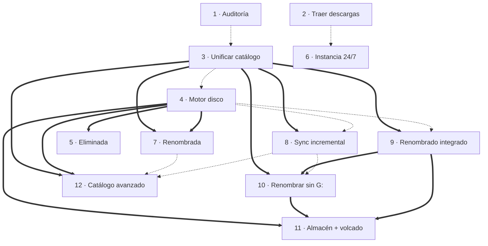

# Plan v3 — Ejecución progresiva de las mejoras

> Resumen del orden de trabajo. El detalle de cada paso está en su propio `feat-*.md`; el análisis que lo justifica, en [`v3-status.md`](v3-status.md).
> Idea de uso: **implementar un feat, probarlo con tus datos y decidir si continúas**. Cada feat es independiente y entrega valor por sí solo.

---

## 1. Cómo leer este plan

- **N** (sufijo del fichero) = dificultad de 1 (más fácil) a 12 (más difícil) y orden recomendado de ejecución.
- **Depende de** distingue *dura* (no se puede hacer sin ella) de *recomendada* (se puede hacer antes, con menos valor).
- Cada feat termina en un estado **desplegable**: si paras ahí, la app queda coherente y el flujo manual restante sigue funcionando.
- **Decisión (2026-10-11): `bdapp` es la única BD y puede reestructurarse;** solo se preservan los datos del catálogo (lotes, colas, URLs, ejecuciones son prescindibles). `feat-uc1-3` elige la estrategia (A aditiva / B catálogo reconstruido, recomendada); el resto de feats migran de forma aditiva sobre ese modelo.
- `sc1`, `sc2`, `accounts_lite` y `accounts_complete` siguen existiendo (solo lectura/respaldo) hasta la fase de retirada (§6). `accounts_complete` se **actualiza una última vez y se importa** en el feat 3.

### Estado final (criterio de «terminado»)
Al completar la serie, la app, solo con `bdapp`: carga el catálogo completo tal cual está en `G:`; mueve, elimina y renombra cuentas **y nodos** reflejándolo en disco; registra **instancias** con sus rutas
y renombra o mueve al workplace principal las carpetas descargadas por otras; renombra sin scripts ni BD externas y **sin G: conectada**; y sincroniza disco ↔ catálogo a demanda.

| Requisito del estado final | Lo cubre |
|---|---|
| Catálogo completo como en G:, BD única | 3 (+8 para mantenerlo) |
| Mover / renombrar nodos y cuentas | 4, 7, 12 |
| Eliminar | 5, 12 |
| Registro de instancias y rutas; renombrar o mover carpetas de otras instancias | 2, 6, 9 |
| Renombrar sin scripts ni BD externas | 3 (índice), 9 |
| Renombrar sin G: | 10, 11 |
| Sincronizar disco ↔ catálogo | 1, 8 |

## 2. Resumen

| N | Feat | Resuelve | Valor inmediato | Riesgo | Depende de | Estimación |
|--:|---|---|---|:-:|---|---|
| 1 ✅ | [`feat-uc3-1`](../tasks/done/v3/feat-uc3-1.md) · Auditoría de discrepancias (solo lectura) — hecho en v3.1.0 | UC3 | Ves exactamente qué está desfasado (rutas muertas, ids repetidos, BD distintas) | ⬤○○○ | — | 1–2 d |
| 2 ✅ | [`feat-uc4-2`](../tasks/done/v3/feat-uc4-2.md) · **Registro de instancias** + traer descargas de otra instancia  — hecho en v3.2.0 | UC4 (pc1) · M1 | Instancias con sus rutas; desaparece la copia manual `tmp → Telegram_Desktop` | ⬤○○○ | — | 3–4 d |
| 3 ✅ | [`feat-uc1-3`](../tasks/done/v3/feat-uc1-3.md) · Unificar catálogo: importar **`accounts_complete`** (catálogo + índice de renombrado) en una BD única | UC1 · base de UC5 | Catálogo con las ~1 231 cuentas y el índice para renombrar ya en `bdapp`; story inbox sin G: | ⬤⬤⬤○ | rec.: 1 y paso 0 (refrescar complete) | 5–6 d |
| 4 ✅ | [`feat-uc2-4`](../tasks/done/v3/feat-uc2-4.md) · Motor de operaciones de disco + mover/renombrar carpetas | UC2 (fase 1) | Mover cuentas/carpetas desde el árbol con BD y disco sincronizados y deshacer | ⬤⬤⬤○ | rec.: 3 | 5–7 d |
| 5 ✅ | [`feat-problem1-5`](../tasks/done/v3/feat-problem1-5.md) · Cuenta eliminada | Problema 1 · M3 | Un gesto: flag + mover a `09.DELETED` + BD | ⬤⬤○○ | **4**; rec.: 3 | 2–3 d |
| 6 ✅ | [`feat-uc4-6`](../tasks/done/v3/feat-uc4-6.md) · Instancia 24/7: publicación + manifiesto | UC4 (inst1) · M1 | `inst1` entrega sola; pc1 recibe resultados reales (adiós «Executed on another instance») | ⬤⬤⬤○ | rec.: 2 | 5–6 d |
| 7 ✅ | [`feat-problem1-7`](../tasks/done/v3/feat-problem1-7.md) · Cuenta renombrada | Problema 1 · M4 | Renombrar/fusionar cuentas con alias, sin reiniciar; lista de 69 candidatos | ⬤⬤⬤⬤ | **4**, **3**; rec.: 1 | 6–8 d |
| 8 ✅ | [`feat-uc3-8`](../tasks/done/v3/feat-uc3-8.md) · Sincronización incremental | UC3 · UC1 (sc1) · M5 | De ~8 min de lectura a segundos–1 min; botón «Verificar cuenta» | ⬤⬤⬤○ | **3**; rec.: 4 | 6–8 d |
| 9 ✅ | [`feat-uc1-9`](../tasks/done/v3/feat-uc1-9.md) · Renombrado integrado | UC1 (sc2) · UC4 | Sin scripts externos; vista previa; renombrar desde cualquier carpeta | ⬤⬤⬤⬤ | **3**; rec.: 4 | 8–10 d |
| 10 ✅ | [`feat-uc5-10`](../tasks/done/v3/feat-uc5-10.md) · Renombrar sin G: (usa el índice cargado en el feat 3) | UC5 | Renombrar con el disco apagado; movimiento pendiente | ⬤⬤⬤○ | **9**, **3**; rec.: 8 | 4–6 d |
| 11 ✅ | [`feat-uc6-11`](../tasks/done/v3/feat-uc6-11.md) · Almacén y volcado a G: | UC6 · M7 | Conectas G: solo para volcar; cola «pendiente de volcar» | ⬤⬤⬤⬤ | **10**, **9**, **4** | 6–8 d |
| 16 ✅ | [`feat-uc2-16`](../tasks/done/v3/feat-uc2-16.md) · Cierre de pendientes: eliminar carpeta vacía, papelera con caducidad, auditoría del índice, almacén en la barra de estado (incremental) | UC2/UC6 | Cierra los pendientes de v3 resolubles sin `G:` real | ⬤⬤⬤○ | 15 | 1 d |
| 22 ✅ | [`feat-uc2-22`](../tasks/done/v3/feat-uc2-22.md) · Stories Inbox: informe de problemas, sobrantes y forzar mover (incremental) | UC2 | Saber qué falló al mover stories sin leer un log | ⬤○○○ | 21 | 0,5 d |
| 23 ✅ | [`feat-uc2-23`](../tasks/done/v3/feat-uc2-23.md) · Ocultar carpetas -Deleted/-Inactive en el árbol del catálogo (incremental) | UC2 | Árbol menos saturado sin perder acceso | ⬤○○○ | 22 | 0,25 d |
| 24 ✅ | [`feat-uc2-24`](../tasks/done/v3/feat-uc2-24.md) · El árbol del catálogo conserva lo expandido al refrescar; -Deleted/-Inactive ocultas por defecto (incremental) | UC2 | Navegar sin reabrir nodos | ⬤○○○ | 23 | 0,25 d |
| 25 ✅ | [`feat-uc2-25`](../tasks/done/v3/feat-uc2-25.md) · Cuentas privadas, OwnerId en el editor, aviso sin G:, ficha copiable, menú reorganizado y mejoras pequeñas (incremental) | UC2 | Menos fricción diaria en editor y catálogo | ⬤⬤○○ | 24 | 1 d |
| 21 ✅ | [`feat-uc2-21`](../tasks/done/v3/feat-uc2-21.md) · Gestión de lotes en la modal (detalle de cuentas, nuevo, mover, borrar, recuperar) y retirada de las colas de la GUI (incremental) | UC2 | Organizar lotes guardados sin decidir de antemano cuántas cuentas llevan | ⬤⬤○○ | 20 | 1 d |
| 20 ✅ | [`feat-uc2-20`](../tasks/done/v3/feat-uc2-20.md) · Buscar en el catálogo por Owner ID, también archivadas/eliminadas (incremental) | UC2 | Localizar una cuenta a partir del ID de la página de Instagram | ⬤○○○ | 19 | 0,5 d |
| 19 ✅ | [`feat-uc2-19`](../tasks/done/v3/feat-uc2-19.md) · Mover cuentas sin empezar a un nuevo lote GUARDADO con nombre elegido (incremental) | UC2 | Como la pausa, pero con nombre propio / sugerido del padre | ⬤○○○ | 18 | 0,5 d |
| 18 ✅ | [`feat-uc2-18`](../tasks/done/v3/feat-uc2-18.md) · Pausar cuentas sin empezar de un lote (mover a lote GUARDADO `_PAUSA`) (incremental) | UC2 | Terminar el lote sin las cuentas enormes y dejarlas para después | ⬤⬤○○ | 17 | 1 d |
| 17 ✅ | [`feat-uc2-17`](../tasks/done/v3/feat-uc2-17.md) · Pausa/reanudación de lotes sueltos y Ejecutar tras Detener (incremental) | UC2 | Corrige «No hay cola en ejecución» y «Batch name already exists» | ⬤○○○ | 16 | 0,5 d |
| 15 ✅ | [`feat-uc2-15`](../tasks/done/v3/feat-uc2-15.md) · El estado también sigue a las carpetas `-Inactive` (incremental) | UC2 | Mover a `-Inactive` marca Inactiva; salir restaura | ⬤⬤○○ | 14 | 0.5 d |
| 14 ✅ | [`feat-uc2-14`](../tasks/done/v3/feat-uc2-14.md) · Estado según carpeta `-Deleted`, color único de eliminadas y ventanas centradas (incremental) | UC2 | El estado sigue a la carpeta; ventanas en el centro del monitor | ⬤⬤○○ | 13 | 1 d |
| 13 ✅ | [`feat-uc2-13`](../tasks/done/v3/feat-uc2-13.md) · Mover con sugerencias, búsqueda, nueva carpeta y multiselección (incremental) | UC2 | Selector de destino con sugerencias inversas; mover varias cuentas | ⬤⬤○○ | 12 | 1 d |
| 12 ✅ | [`feat-uc2-12`](../tasks/done/v3/feat-uc2-12.md) · Catálogo avanzado | UC2 (fase 2) | Eliminar con cuarentena, fusionar, ficha editable, arrastrar y soltar | ⬤⬤⬤⬤ | **4**, **3**; rec.: 7, 8 | 8–10 d |

Total orientativo: **59–76 días de desarrollo** (no incluye las pruebas manuales sobre datos reales, que conviene hacer feat a feat). Es una estimación gruesa para decidir orden, no un compromiso.

## 3. Dependencias

Leyenda: flecha gruesa = dependencia dura · flecha punteada = recomendada.

## 4. Fases y puntos de decisión

### Fase A — Ver y simplificar (feats 1–2) · sin riesgo para los datos
Objetivo: medir el problema y quitar el paso manual más tedioso.
- Entregable: informe de discrepancias reales y botón «Traer descargas».
- **Punto de decisión A:** con el informe, confirmar o corregir las suposiciones **Q3, Q1, Q2** de `v3-status.md` (¿los 69 grupos son renombrados?, ¿`DELETED` ≠ `DISABLED`?, ¿destino plano?).

### Fase B — Una sola fuente de verdad y escritura segura (feats 3–5)
Objetivo: `bdapp` conoce toda la biblioteca y la app sabe modificar el disco con garantías.
- Entregable: catálogo completo, mover/renombrar carpetas, «cuenta eliminada» en un gesto.
- **Punto de decisión B:** probar `feat-uc2-4` solo sobre `10.TEMP` y una copia pequeña antes de usarlo en `FAVORITES`. Si el diario/deshacer no convence, **parar aquí**: las fases siguientes dependen de él.

### Fase C — Dos instancias (feat 6)
Objetivo: eliminar el viaje por escritorio remoto.
- Puede adelantarse a la Fase B si el dolor mayor es M1 (solo depende, de forma recomendada, del feat 2).
- **Punto de decisión C:** Q4 (versiones iguales en las dos instancias) y Q5 (¿`inst1` ve G:?).

### Fase D — Problema 1 completo y sincronización barata (feats 7–8)
Objetivo: cuentas renombradas resueltas en la app y fin de `sc1` como proceso manual.
- **Punto de decisión D:** con `feat-uc3-8` funcionando 2–3 semanas, dejar de ejecutar `sc1` (conservar `generatedirmap.py` como respaldo).

### Fase E — Renombrado dentro de la app, con y sin disco (feats 9–11)
Objetivo: `sc2` deja de ser necesario y G: solo se conecta para volcar.
- Orden estricto: 9 → 10 → 11.
- **Punto de decisión E1 (tras 9):** modo `renaming.engine = integrated` en paralelo con `legacy_sc2` durante varios lotes reales; comparar resultados.
- **Punto de decisión E2 (tras 10):** si el índice se mantiene fresco en la práctica (la verificación no muestra deriva) → se autoriza el almacén.

### Fase F — Pulido (feat 12)
Objetivo: catálogo completo (eliminar, fusionar, ficha, DnD). Se puede entregar en tres partes (12a/12b/12c).

## 5. Caminos cortos según prioridad

| Si lo que más te duele es… | Camino mínimo | Qué quedas teniendo |
|---|---|---|
| Copiar a mano entre instancias | 2 → 6 | Entrega automática y resultados reales de `inst1` |
| Cuentas eliminadas/renombradas | 3 → 4 → 5 → 7 (+1 para ver los candidatos) | Problema 1 completo |
| Releer el disco / sincronizar | 3 → 8 | Sincronización incremental |
| Renombrar sin G: | 3 → 9 → 10 (+4 para mover con seguridad) | Renombrado offline con movimiento pendiente |
| Dejar G: desconectada | 3 → 4 → 9 → 10 → 11 | Flujo completo con almacén y volcado |

## 6. Retirada gradual de los scripts (solo cuando se hayan validado)

| Cuándo | Qué se retira / apaga | Condición |
|---|---|---|
| Tras feat 8 + 2–3 semanas de uso | Dejar de ejecutar `sc1` (`--lite`, `--update`, `--complete`) | Auditoría (`feat-uc3-1`) sin discrepancias nuevas tras varios lotes |
| Tras feat 9 + varios lotes reales | `renaming.engine = integrated` por defecto; `legacy_sc2` queda como opción | Paridad validada (E1) |
| Tras feat 3 (importación validada) | Archivar `accounts_complete.sqlite` y `accounts_lite.sqlite` como respaldo; ya no se leen salvo por `sc2`/espejo transitorios | Informe de importación sin incidencias graves; cifras de `bdapp` = cifras de complete |
| Tras feat 10 | Verificar el índice con el disco | «Verificar índice» sin deriva relevante |
| Tras feat 9 + 10 | Apagar `compat.lite.enabled`; archivar `accounts_lite.sqlite`; quitar `stories.accounts_db_path` | Ningún consumidor lee lite (story inbox ya usa `bdapp`) |
| Final | Quitar `MANUAL_RENAME_SCRIPT`, `POST_PROCESS_COMMAND` y `orchestration/post_processing.py` si no se usan; actualizar `CLAUDE.md` | Todo lo anterior hecho |

Los directorios `GenerateDirMap` y `ManualRenameFiles` **no se borran**: se archivan como referencia (están bajo `D:\Archivos\Scripts\IG`).

## 7. Reglas transversales para cada feat

1. **Copia de seguridad antes de migrar:** al arrancar con una migración pendiente, copiar `orchestrator_gui.sqlite` a `data/bkp/orchestrator_gui_<fecha>_<user_version>.sqlite` con la API de backup de SQLite (la BD pesa ~9 MB; con el índice, ~60–90 MB). Se implementa en `feat-uc1-3` (primera migración). Aunque los lotes sean prescindibles, el catálogo (favoritos, estados, ids, fechas) no lo es.
2. **Paso 0 del feat 3:** con G: conectada, `generatedirmap.py --lite` y `--update` (o `--complete`) para dejar `accounts_complete` al día antes de importar. Es la última vez que se usa `sc1`.
2. **Interruptores de reversa** en `app_settings`: `compat.lite.enabled`, `renaming.engine`, `library.scan.*`. Cada feat nuevo tiene un modo «antiguo» hasta ser validado.
3. **Nunca operar sobre datos reales primero:** probar con `10.TEMP` (2 cuentas) o con copias de 1–2 cuentas pequeñas; las operaciones destructivas empiezan siempre en vista previa.
4. **Pruebas:** cada feat añade tests unitarios (SQLite temporal, árboles en `tmp_path`, sin Telegram ni G: reales). Los feats 9–11 añaden pruebas de **paridad** contra `sc2`.
5. **Convenciones del repo (`CLAUDE.md`/`AGENTS.md`):** una tarea cada vez; `CHANGELOG.md` con versión/fecha/ficheros/pruebas; `MODULE.md` por paquete nuevo; **al terminar cada feat, mover su `docs/feat-*.md` a `tasks/done/v3/`** (y actualizar los enlaces de este plan); **añadir su sección a `docs/tutorial-v3.md`** (dónde está la opción, qué hace cada botón/campo, qué rellenar y cómo probarla); commit con prefijo `feat:`/`fix:`.
6. **Versionado:** cada feat = un minor `v3.x.0` en el **orden en que se ejecuten** (el primero que se implemente será `v3.1.0`), con parches `v3.x.y` para arreglos.
7. **Rama:** `v3/integration` es la rama base; una rama corta por feat (`v3/feat-uc3-1`…) que se fusiona al terminar y probar.
8. **Datos de dos instancias:** el esquema de `bdapp` debe ser idéntico en `pc1` e `inst1`; desplegar el mismo código en ambas antes de usar el intercambio (`feat-uc4-6` lo valida con `min_reader_version`).

## 8. Proceso manual que sigues mientras tanto

| Hasta que exista… | Sigue haciendo |
|---|---|
| Feat 2 | Copiar `tmp → Telegram_Desktop` |
| Feat 6 | Usar «Ejecutado en otra instancia» (sabiendo que marca `FAILED_FINAL`) |
| Feat 5 / 7 | Mover/renombrar a mano y editar `lite` + `complete` (la auditoría del feat 1 ayuda a encontrarlo) |
| Feat 8 | `sc1 --lite` + `--update` cuando haga falta |
| Feat 9 | Renombrar con `sc2` y G: conectada |

## 9. Decisiones pendientes que condicionan el orden

| ID | Pregunta | Afecta a | Si no se decide… |
|---|---|---|---|
| Q1 | ¿`DELETED` distinto de `DISABLED`? | feat 5 | Se implementa con ambos (propuesta) |
| Q2 | ¿Destino de eliminadas plano o con grupo? | feat 5 | Plano, como ya está `09.DELETED` |
| Q3 | ¿Qué son los 69 grupos de `ownerId` repetido? | feat 7 | Lo responde el informe del feat 1 |
| Q4 | ¿Misma versión en las dos instancias? | feat 6 | Se exige vía `min_reader_version` |
| Q5 | ¿`inst1` ve G:? | feats 6, 10, 11 | Se asume que no |
| Q6 | Ruta del almacén (UC6) | feat 11 | `D:\Archivos\IG\Procesadas`, editable |
| Q7 | ¿Se puede modificar `sc2` ya? | feat 2 | No es necesario (el feat 2 mueve a la carpeta de trabajo) |
| Q8 | ¿Conservar `compareProcess`? | backlog | Aparcado |
| Q9 | Cambio de `ownerId` y nombres ya escritos | feat 12 | Solo aviso, no renombra ficheros |

## 10. Siguiente paso recomendado

Empezar por **`feat-uc3-1`** (1–2 días, no escribe nada) y **`feat-uc4-2`** (2–3 días). Con el informe del primero se revisa este plan antes de entrar en la Fase B.
