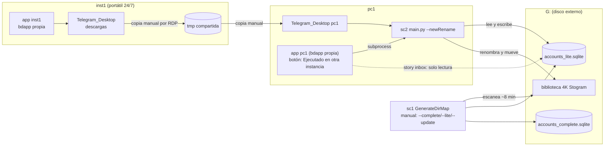

# v3 — Estado actual y análisis

> Documento de partida de la serie v3. Recoge **lo que se pidió** (sección 1) y **el análisis del estado
> actual** de la app, los scripts, las bases de datos y los procesos manuales (secciones 2–7).
> Las propuestas están en `docs/feat-*.md` y el orden de ejecución en `docs/plan-v3-features.md`.
>
> Fecha del análisis: 2026-10-11 · Rama: `v3/integration` · Versión de la app: v2.2.0
> Todas las cifras de este documento son **medidas reales** sobre tus bases de datos y tu disco G:
> (solo lectura; no se modificó nada). Se indica la fecha de cada fuente cuando importa.

---

## 1. Qué se pidió (enunciado ordenado)

### 1.1 Variables de referencia

| Variable | Significado |
|---|---|
| `app` | El orquestador (`ig_orchestrator`) |
| `bdapp` | `data/orchestrator_gui.sqlite` (SQLite v2 de la app) |
| `sc1` | Script **GenerateDirMap** (`D:\Archivos\Scripts\IG\GenerateDirMap`) |
| `bdsc1` | BD de sc1: `G:\4K Stogram\accounts_lite.sqlite` (**y** `accounts_complete.sqlite`, ver §4.2) |
| `sc2` | Script **ManualRenameFiles** (`D:\Archivos\Scripts\IG\ManualRenameFiles`) |
| `inst1` | Instancia que corre 24/7 los batches (portátil `DESKTOP-OM856P7`) |
| `pc1` | PC principal donde trabajas y que apagas constantemente |
| `G:` | Disco duro externo con la biblioteca `G:\4K Stogram` |

### 1.2 Cómo funciona hoy, según tu descripción

1. `bdapp` guarda lo que maneja el orquestador (cuentas, lotes, URLs, ejecuciones).
2. En `G:\4K Stogram` están todas las carpetas de cuentas descargadas. `sc1` recorre ese árbol,
   detecta las carpetas de cuenta por su contenido y genera `bdsc1`.
3. `sc2` renombra los ficheros descargados al formato requerido y mueve las carpetas a sus sitios en `G:`.
   El orquestador lo invoca al terminar los lotes.
4. `inst1` ejecuta batches de noche. Tú entras por escritorio remoto, copias lo descargado
   (`C:\Users\eduba\Downloads\DW\Telegram_Desktop`) a la carpeta compartida
   `C:\Eduardo\ig_orchestrator\tmp` (visible en pc1 como `\\DESKTOP-OM856P7\ig_orchestrator\tmp`),
   lo copias a `Telegram_Desktop` de pc1, abres la app en pc1, pulsas **«Ejecutado en otra instancia»** y
   renombras. Para renombrar **G: tiene que estar conectada**.

### 1.3 Problemas recurrentes

- **Problema 1 — cuentas eliminadas o renombradas en Instagram.**
  - *Eliminada:* además del flag en la app, mover la carpeta a otro sitio y actualizar rutas en las BD (hoy a mano).
  - *Renombrada* (mismo id, otro username): buscar por `ownerId` / `instagram_user_id` en las dos BD, renombrar
    en ambas, y cerrar/abrir la app para que refresque (hoy a mano).

### 1.4 Casos de uso deseados

| ID | Resumen |
|---|---|
| **UC1** | Todo integrado en la app y en `bdapp`: traer la lógica útil de `sc1` y `sc2` como módulos (no «tal cual»), sin scripts aparte ni desincronización. |
| **UC2** | Catálogo (árbol) poderoso: mover, eliminar, renombrar carpetas, editar datos del username (p. ej. id). Cada acción se replica en disco y en BD; el catálogo refleja el disco. |
| **UC3** | Sincronización disco ↔ BD sin leer miles de carpetas cada vez ni al arrancar (minutos y desgaste del disco). Discrepancias mínimas, corregibles desde la app. |
| **UC4** | «Ejecución en otra instancia»: mover ficheros entre instancias desde la app (carpetas compartidas configurables, modal que pregunta dónde están los ficheros a renombrar). |
| **UC5** | Renombrar **sin** G: conectada: guardar en una tabla lo que `sc2` necesita (última numeración/fecha…) en lugar de leerlo del disco. |
| **UC6** | Tras renombrar, elegir dónde dejar las carpetas procesadas (almacén temporal) y, con otra opción, hacer un **«volcado»** a G: cuando se conecte. |

### 1.5 Entregables pedidos

1. Análisis (este documento) → `docs/v3-status.md`.
2. Un `.md` por propuesta (`feat-<caso>-<N>.md`, **N = dificultad 1…12**, 1 = más fácil, único por feat).
3. Un plan ordenado → `docs/plan-v3-features.md`.

Requisito transversal: se puede ejecutar el plan **progresivamente**; cada feat es independiente y entrega valor por sí solo.

---

### 1.6 Decisiones y aclaraciones posteriores (2026-10-11)

1. **El catálogo de 334 cuentas es el esperado:** se alimentó según se añadían o actualizaban cuentas; no es un fallo.
2. **`accounts_lite` es la versión ligera de `accounts_complete`;** la carga de `complete` es la compleja y estructurada (es la referencia). Como `complete` contiene la información necesaria para renombrar (tabla `media`),
   **el primer paso es actualizar `accounts_complete` y llevar a `bdapp` las columnas útiles para el catálogo y el renombrado** (→ `feat-uc1-3`).
3. **Una única base de datos: `bdapp`.** Se puede reestructurar (tablas, relaciones, exportar datos). **Solo importan los datos del catálogo**; lotes, colas, URLs, ejecuciones pueden descartarse si hace falta rediseñar.
4. **Estado final deseado** (criterio de «terminado» de toda la serie v3):
   - cargar con su propia BD el **catálogo completo tal cual está en G:**;
   - **mover, eliminar y renombrar** cuentas (usernames) **y nodos del catálogo** (categorías/grupos), con efecto real en disco;
   - **registro de instancias con sus rutas**, para interactuar con carpetas descargadas por otras instancias: renombrarlas ahí o moverlas al workplace de la instancia principal;
   - **renombrar sin ningún script ni base externa**, solo con `bdapp` y el código de la app;
   - renombrar **sin G: conectada** y **sincronizar disco ↔ catálogo** a demanda.

## 2. Mapa del sistema actual

Observaciones clave del diagrama:

- Hay **cuatro almacenes de verdad parciales**: `bdapp` de pc1, `bdapp` de inst1 (son ficheros distintos), `accounts_lite` y `accounts_complete`.
- Dos de ellos viven **en G:**, así que sin el disco no hay datos de rutas ni de numeración.
- Quien escribe en `accounts_lite` son **dos actores independientes** (sc1 y sc2); la app solo lo lee.
- El paso inst1 → pc1 es **100 % manual** y la app lo representa con un parche (marcar el lote como fallido «ejecutado en otra instancia»).

---

## 3. La app (`ig_orchestrator` v2.2.0)

### 3.1 Qué hace bien y debe conservarse

- Orquestación robusta: importación de lotes, reintentos, stories primero, reanudación desde SQLite, reportes, notificaciones.
- GUI modular (`gui/{catalog,editor,batches,run,settings,stories,...}`) con `MODULE.md` por paquete.
- `bdapp` v2 normalizada (tablas `catalog_*`, `batch_*`, `path_roots`, `app_settings`) con **vistas de compatibilidad** (`accounts`, `url_jobs`, …) que permiten que el código v1 siga funcionando.
- Migraciones controladas por `PRAGMA user_version` (actual = 100) en `db/gui_migrations.py`.
- Export/import de lotes portable (`gui/batches/transfer.py`, formato `ig_orchestrator.batch_export` v1).

### 3.2 `bdapp` hoy (medido)

| Tabla | Filas | Nota |
|---|---:|---|
| `catalog_accounts` | **334** | 263 ENABLED, 35 INACTIVE, 36 DISABLED |
| `catalog_folders` | 87 | profundidad 0 (raíz `G:\4K Stogram`), 1 (11 categorías), 2 (75 grupos/personas) |
| `batches` / `batch_accounts` | 120 / 3 799 | |
| `batch_urls` / `batch_runs` | 25 226 / 3 118 | |
| `downloaded_files` | 0 | se purga al completar (`retention.downloaded_files = on_complete`) |
| `path_roots` | 3 | `TELEGRAM_DESKTOP`, `WORKING` y **`FINAL_BASE` vacío** (preparado, nunca usado) |

Hallazgos relevantes para v3:

1. **El catálogo de la app cubre solo ~27 % de la biblioteca** (334 de 1 231 carpetas de cuenta): básicamente `00.FAVORITES`.
   Las otras 16 categorías (MODELS-A/B/C/D…, EXCLUDED, DELETED, PRIVATE…) solo existen en `bdsc1`.
2. `catalog_accounts` **no guarda la ruta de la cuenta**: la deriva de `folder_id → catalog_folders.full_path` + `username`.
   Además `catalog_folders.full_path` son rutas **absolutas con letra de unidad** (`G:\...`): no sirven si la unidad cambia
   de letra, si G: está desconectada o si se usa un almacén temporal.
3. `catalog_accounts` tiene `instagram_user_id` (311/334 rellenos) y `start_init_date` (120/334), pero **no** tiene contadores,
   fecha del último contenido, ni historial de usernames.
4. El menú contextual del catálogo (`gui/catalog/panel.py:190-207`: Abrir, Inactivo, Favorito, Quitar favorito, Delete, Activar)
   **solo cambia estados en `bdapp`**. «Delete» = `DISABLED`; no toca disco ni `bdsc1`. Es el «flag deleted» del que hablas.
5. El estado «Ejecutado en otra instancia» (`gui/batches/resume.py:477`) **marca todas las URLs pendientes como `FAILED_FINAL`**
   con `last_error_type = EXECUTED_ELSEWHERE` y las cuentas como `COMPLETED`: se pierde el resultado real (qué se descargó
   y qué falló) y los informes de pc1 mienten. **Medido:** 18 651 de las 25 226 URLs de `bdapp` (74 %) están en `FAILED_FINAL` con el
   texto «Executed on another instance», repartidas en 41 de los 120 lotes. Cualquier estadística de fallos (p. ej. para detectar cuentas
   eliminadas) queda contaminada por este parche.
6. El renombrado se lanza **como subproceso** de un script con ruta **fija en el código**
   (`gui/run/process_runner.py:12`, `MANUAL_RENAME_SCRIPT = D:\Archivos\Scripts\IG\ManualRenameFiles\main.py`). En inst1 solo
   funcionaría si el script está en la misma ruta. La app detecta el éxito por código de salida y por «carpetas sobrantes»
   (`gui/run/leftovers.py`), no por datos estructurados.
7. El *story inbox* (`filesystem/story_inbox.py`) busca la ruta de cada cuenta en `accounts_dir` de `accounts_lite.sqlite`
   (`app_settings.stories.accounts_db_path`), **no** en `bdapp`. Si el username cambió o la cuenta no está en lite, falla (`USERNAME_NOT_IN_DB`).
8. `bdapp` y `bdsc1` ya coinciden bastante en las cuentas que comparten: de 329 usernames comunes, **4** tienen `ownerId`
   distinto y 1 tiene carpeta distinta. 5 cuentas (todas `DISABLED`) de la app no existen en lite.

### 3.3 Configuración de rutas hoy

- `.env` (pc1 e inst1 son idénticos en rutas): `TELEGRAM_DESKTOP_DOWNLOAD_FOLDER = WORKING_FOLDER = C:\Users\eduba\Downloads\DW\Telegram_Desktop`.
- `app_settings`: `stories.inbox_path`, `stories.accounts_db_path` (apunta a `G:/4K Stogram/accounts_lite.sqlite`).
- Las rutas de `sc2` (`manualFolder`, `consultFoldersBD`) viven **en el `config.json` de sc2**, no en la app.
- No existe el concepto de «carpeta de intercambio», «almacén de procesadas» ni «rol de instancia».

---

## 4. Los scripts

### 4.1 `sc1` — GenerateDirMap (`generatedirmap.py`, 956 líneas, solo librería estándar)

Tres modos excluyentes (`--complete`, `--lite`, `--update`), configurados en `config.json`
(`dir_input = G:\4K Stogram`, `level_folder = 3`, `multimedia_folders = reels,story,highlights`,
extensiones `mp4,mov,wmv,jpe,jpeg,jpg,png`).

| Modo | Qué hace | Coste observado (`generatedirmap.log`) |
|---|---|---|
| `--complete` | Recorre el árbol (BFS hasta nivel 3), detecta cuentas, cuenta posts/reels/story/highlights, calcula `ownerId` y `last_modified`, y vuelca **cada fichero con `media_id`** a la tabla `media`. | **455 s (2026-07-02) y 504 s (2026-07-15)**; ~906 000 filas de media |
| `--lite` | Mismo recorrido y misma detección, pero solo guarda `username → path` (+`ownerId` copiado de `complete`). Borra rutas que ya no existen (si no hubo errores). | **13 s a 55 s** (según caché) |
| `--update` | Compara `accounts_dir` (lite) con `accounts` (complete) por username. Si la ruta difiere, **re-escanea esa cuenta entera** y reconstruye sus `media`. | 2 s a 32 s según cuántas cuentas cambiaron |

Reglas útiles que hay que **conservar** (están en el código, no solo en la documentación):

- **Detección de carpeta de cuenta:** tiene ficheros multimedia directos, **o** una subcarpeta conocida (`reels`/`story`/`highlights`) con multimedia; deja de descender al detectar una.
- **Carpetas de categoría, nunca usernames:** `.thumb.stogram, highlights, mobile, reels, story, tagged, telegram, otros, captura` (constante en el código, no configurable).
- **Regex de nombre:** `YYYY-MM-DD HH.MM.SS {media_id}_{owner_id}[_|-|espacio…].ext`.
- **`ownerId`:** el más frecuente en `story` → `highlights` → `reels` → raíz (se queda con el primer nivel que dé resultado).
- **Contadores:** ficheros multimedia directos en raíz / `reels` / `story` / `highlights` (cuentan aunque no cumplan la regex).
- **`last_modified`:** el timestamp más reciente parseado de los nombres válidos.
- **Poda segura:** no borra filas de lite si hubo errores de lectura en el recorrido.

Problemas / deuda detectada:

- **Dos significados para `last_modified`.** `sc1` lo deja a `NULL` en lite; `sc2` lo rellena con `startNowDate` al registrar una cuenta nueva
  (`account_database.py:87`). Resultado real: solo **120 de 1 231** filas lo tienen y significan «fecha del lote», no «último contenido».
- **Dos formatos de fecha** en la misma columna: `2026-07-18 12:13:32` (sc1) e ISO `2026-10-08T10:53:54` (sc2): evidencia de que hay **dos escritores**.
- `complete` es **opcional y se queda viejo** (último `--update`: 2026-07-18). Hoy: 1 119 cuentas vs 1 231 en lite; 138 en lite sin fila en complete; 24 en complete que ya no están en lite; **116 con ruta distinta** entre ambas.
- `field1..3` existen en todas las tablas y **no se usan**.
- Cualquier cambio manual en disco (mover, renombrar, eliminar) deja las BD desfasadas hasta el siguiente escaneo; no hay detección de renombrados por `ownerId`.
- Ejecución solo manual, con `G:` imprescindible.

### 4.2 `bdsc1` — `accounts_lite.sqlite` y `accounts_complete.sqlite`

> **Matiz importante:** la «bdsc1» tiene **dos ficheros**. Lo que `sc2` y el story inbox usan es `accounts_lite`;
> la tabla `media` (≈910 000 filas) solo está en `accounts_complete` y es la que habilita UC5.

| Fichero | Tabla | Filas | Tamaño | Última escritura |
|---|---|---:|---:|---|
| `accounts_lite.sqlite` | `accounts_dir(id, username, ownerId, path UNIQUE, last_modified, created_at, modified_at, field1-3)` | 1 231 | 0,27 MB | 2026-10-09 |
| `accounts_complete.sqlite` | `accounts(…, posts, reels, story, highlights, last_modified …)` | 1 119 | 282 MB total | 2026-07-18 |
| `accounts_complete.sqlite` | `media(id_accounts, username, filename, path, type, …)` | **909 929** | | |

Distribución de `media` (julio): POST 426 685 · REELS 234 404 · STORY 140 570 · HIGHLIGHTS 108 270.

Estructura real de la biblioteca (desde lite):

- **Profundidad 3** (`categoría\grupo-persona\username`): `00.FAVORITES` (334 cuentas en 56 grupos, hasta 41 por grupo), `00.MODELS-A` (223/40), `00.MODELS-B` (166/43), `00.MODELS-C` (99/37).
- **Profundidad 2** (`categoría\username`): `00.MODELS-D/I/R/V`, `02.PRIVATE`, `03.LOW_ACTIVITY`, `04.INACTIVE`, `06.EXCLUDED` (139), `07.EXCLUDED_PRIVATE`, **`09.DELETED` (134)**, `10.TEMP`, `11.DISCARTED`.
- Es decir: **ya existe una carpeta `09.DELETED` con 134 cuentas** — el destino natural del flujo «cuenta eliminada» del Problema 1.

Salud de los datos hoy (medida el 2026-10-11):

| Comprobación | Resultado |
|---|---:|
| Rutas de lite que **ya no existen** en disco | **15** (13 en `00.MODELS-B`) |
| `ownerId` con **más de un username** en lite | **69 grupos** (58 pares, 7 tríos, 1 cuarteto, 3 quintetos) |
| …de esos: todo dentro de `00.FAVORITES` | 19 · todo dentro de `09.DELETED` 11 · `06.EXCLUDED`+`09.DELETED` 5 · otras combinaciones 34 (p. ej. 9 dentro de `MODELS-A`, 6 dentro de `MODELS-B`) |
| `ownerId` con >1 username en complete | 76 |
| Lite ↔ complete: ruta distinta | 116 |
| Lite ↔ bdapp: `ownerId` distinto / carpeta distinta | 4 / 1 |
| Lite con `ownerId` | 1 231 / 1 231 (1 144 ids distintos) |

Los 69 grupos son **candidatos** a «cuenta renombrada» (la causa del Problema 1) o a duplicados legítimos; la propuesta `feat-uc3-1` los lista sin tocar nada para que decidas.

### 4.3 `sc2` — ManualRenameFiles (`main.py`, `config.py`, `folder_processor.py`, `timeline_builder.py`, `file_utils.py`, `account_database.py`, `compare_dirs.py`)

Tiene **tres modos**, de los cuales la app solo usa uno:

| Modo | Activación | Lo usa la app |
|---|---|---|
| **`newRename`** | `--newRename --startNowDate … [--new-account U ID FECHA RUTA]… --no-duplicated --move-renamed` | ✅ (única llamada, `process_runner.py:35`) |
| `renameProcess` (histórico) | `python main.py` con `config.json` (`consultFolders` = 6 raíces fijas, `flagNew`, `newUser`) | ❌ |
| `compareProcess` (`compare_move` / `replace`) | `config.json` → `compareProcess.enabled/replace` | ❌ (herramienta aparte de comparar/reemplazar vídeos por tamaño) |

Algoritmo de `newRename` (lo que hay que portar para UC1/UC5):

1. Por cada subcarpeta de `manualFolder` (= `Telegram_Desktop`), buscar el username en `accounts_dir` (sin mayúsculas). Si es nueva y viene con `--new-account`, usar la ruta/ownerId/`startInitDate` dados y **insertarla en `accounts_dir`** al final.
2. Para cada carpeta y subcarpeta equivalente (`story`, `reels`, `highlights`, raíz): leer los ficheros **ya renombrados** de la carpeta de la biblioteca (`consult`), regex `fecha media_id_owner…ext` y solo `jpg/jpeg/mp4`.
3. Ficheros descargados (`manual`, nombre `^\d{10,}\.(jpg|jpeg|mp4)$`): si su `media_id` ya está en `consult` → renombrar `{id}_duplicated.ext` (y borrar si `--no-duplicated`).
4. Agrupar los restantes por **prefijo de 6 dígitos del id** (bloques) y ordenarlos junto a `consult` por id. Los ids de Instagram son cronológicos, así que **la fecha se interpola entre los vecinos `consult`** por id:
   - bloques por encima del último `consult` → repartidos entre la última fecha y «ahora» (`startNowDate` + hora actual), con minutos/segundos aleatorios;
   - bloques entre dos `consult` → reparto uniforme entre ambas fechas;
   - bloques sin vecino anterior → «ahora» o fecha anterior menos horas.
   - cuentas nuevas sin `consult`: reparto lineal entre `startInitDate` y `startNowDate`.
5. Nombre final: `YYYY-MM-DD HH.MM.SS {media_id}_{ownerId}_manual.ext`; si colisiona se añade `(n)`. Dentro de un bloque se generan horas descendentes.
6. `user_id` = el de los vecinos `consult` (hacia delante, luego hacia atrás); en cuentas nuevas el forzado; si no hay: `unknown`.
7. `--move-renamed`: mover la carpeta al **padre de la carpeta consult**, fusionando con la existente **sin sobrescribir** (si hay colisión de ficheros se aborta esa carpeta).

**Qué necesita realmente `sc2` de la biblioteca (clave para UC5):** por cada carpeta y cuenta, la lista ordenada de
`(media_id, fecha, owner_id)` de lo ya renombrado. Nada más. Eso equivale exactamente a los **nombres de fichero** que `sc1 --complete`
ya guarda en `media` (`909 929` filas): es información que **ya existe en una tabla**, pero está en `accounts_complete.sqlite`,
desactualizada (julio) y en G:.

Deuda / riesgos de `sc2`:

- Rutas fijas (`G:\4K Stogram\accounts_lite.sqlite`, `Telegram_Desktop`) en `config.json`; `newRename` **rechaza** `--manualFolder` y `--ignoreConfig` a propósito. No hay forma de pasarle «una carpeta de origen distinta» sin tocar el script (afecta a UC4).
- Escribe en `accounts_lite` (INSERT de cuentas nuevas) sin pasar por la app → `catalog_accounts` y `accounts_dir` se desincronizan (se resuelven con pasos manuales).
- Resultado solo por stdout/código de salida.
- Aleatoriedad (`random`) en horas: dos ejecuciones dan nombres distintos (relevante para pruebas de paridad: se necesitará fijar semilla).
- Ignora `.png/.mov/.wmv` en la lectura de `consult` aunque `sc1` sí las indexa (en la práctica no afecta hoy: de las 909 929 filas de `media`, 515 579 son `jpg`, 382 697 `mp4` y 11 653 `jpeg`; 909 921 cumplen el regex de `sc2`).
- Detecta duplicados solo dentro de la misma subcarpeta (un id repetido entre `reels` y raíz no se detecta).

---

## 5. Procesos manuales (qué haces tú hoy y qué los reemplaza)

| # | Proceso manual actual | Pasos humanos | Riesgo | Reemplazo propuesto |
|---|---|---|---|---|
| M1 | Traer descargas de inst1 a pc1 | RDP → copiar a `tmp` → copiar a `Telegram_Desktop` de pc1 → marcar «Ejecutado en otra instancia» | olvidar carpetas, copias a medias, informes falsos | `feat-uc4-2`, `feat-uc4-6` |
| M2 | Renombrar con G: conectada | conectar G: → botón Renombrar | sin G: es imposible | `feat-uc1-9`, `feat-uc5-10` |
| M3 | Cuenta eliminada | flag en app → mover carpeta a mano → editar `lite` y `complete` | rutas rotas, story inbox falla | `feat-problem1-5` |
| M4 | Cuenta renombrada | buscar por id en 2 BD → renombrar carpeta → renombrar en 2 BD → reiniciar app | pérdida de histórico, duplicados | `feat-problem1-7` |
| M5 | Resincronizar `bdsc1` | ejecutar `sc1 --complete/--lite/--update` con G: | 8 min de lectura intensa del HDD USB | `feat-uc3-8` (+ `feat-uc3-1` para auditar) |
| M6 | Catálogo desactualizado tras mover carpetas | mover en Explorer → editar BD | catálogo ≠ disco | `feat-uc2-4`, `feat-uc2-12` |
| M7 | Volcado de procesadas a G: | hoy `sc2` mueve directamente a G: (necesita G: ya) | bloquea el flujo | `feat-uc6-11` |

---

## 6. Análisis de integración (CasoUso1): qué traer y qué descartar

Criterio de la petición: *«la idea no es traer todo tal cual está»*.

| Pieza heredada | Decisión | Dónde vive en v3 | Motivo |
|---|---|---|---|
| Reglas de detección de cuenta (`is_account_folder`, categorías no-usuario) | **Traer** y hacer configurables | `app_settings` (`library.*`) + módulo `library/detect.py` | Hoy están «hardcodeadas» en el script |
| Regex de nombre y parseo `media_id/owner_id/fecha` | **Traer** (un único módulo) | `library/filenames.py` | Lo usan sc1 y sc2 con regex casi iguales |
| Cálculo de `ownerId`, contadores, `last_modified` | **Traer** | `library/scanner.py` → columnas de `catalog_accounts` | |
| 3 modos complete/lite/update | **Descartar** | un único escáner incremental (`feat-uc3-8`) | Eran una solución a que el escaneo completo era caro |
| `accounts_complete` como **fuente de datos** | **Importar primero (una vez) y archivar** | catálogo + `media_index` en `bdapp` (`feat-uc1-3`); su algoritmo de carga se porta al escáner (`feat-uc3-8`) | Es la fuente estructurada y contiene lo necesario para renombrar |
| `accounts_complete` como fichero aparte | **Descartar tras importar** | — | Una única BD |
| `accounts_lite` como fichero aparte | **Descartar tras migrar**; mientras tanto **espejo de compatibilidad** (bdapp → lite) | `library/compat_lite.py` | `sc2` y el story inbox lo siguen leyendo hasta migrar |
| `field1..3` | **Descartar** | — | Sin uso |
| `last_modified` ambiguo | **Separar** | `last_media_at` (contenido) y `start_init_date` / `last_batch_date` | Dos significados hoy |
| `newRename` (algoritmo de fechas/ids, duplicados, mover/fusionar) | **Traer** con pruebas de paridad | `renaming/` | Es el valor de sc2 |
| `renameProcess` histórico (`consultFolders`, `flagNew`) | **Descartar** | — | La app no lo usa; `catalog_accounts.folder_id` lo sustituye |
| `compareProcess` (compare_move / replace) | **Aparcar** como herramienta | opcional en backlog (`feat-uc2-12`, sección «fuera de alcance») | Uso esporádico, sin relación con el flujo principal |
| `.bat` (`MRF.bat`, `MRF_auto.bat`, `POST_PROCESS_COMMAND`) | **Descartar** al integrar `renaming/` | — | Subproceso innecesario |
| `random` en horas | **Traer inyectable** (semilla opcional) | `renaming/dates.py(rng)` | Tests deterministas |

---

## 7. Diagnóstico por caso de uso

| Caso | ¿Qué falta? | Evidencia |
|---|---|---|
| UC1 | `bdapp` no conoce el 73 % de la biblioteca ni rutas relativas; la lógica está duplicada en dos scripts con rutas fijas | §3.2, §4 |
| UC2 | El menú solo cambia estados; no hay capa que ejecute operaciones de disco con transacción, deshacer y doble escritura | `catalog/panel.py:190-207` |
| UC3 | El mecanismo de «lo cambiado» no existe: o se lee todo (455-504 s) o nada | logs de sc1 |
| UC4 | Sin concepto de instancia ni de carpeta de intercambio; «Ejecutado en otra instancia» destruye información | `resume.py:477` |
| UC5 | La información existe en `media` pero está en G: y desactualizada | §4.2 |
| UC6 | No hay almacén de procesadas; `sc2` mueve directamente a la biblioteca | `main.py:129` |

### 7.1 Medición que sustenta la propuesta de UC3

Medido hoy sobre G: (NTFS en HDD USB WD Elements), **solo metadatos** (sin listar ficheros):

- `stat` de las 1 231 carpetas de cuenta + sus `story/reels/highlights`: **4 721 llamadas en 41,3 s en frío** (629 carpetas con cambios en los últimos 30 días).
- `scandir` de los niveles 1–2 del árbol: **< 0,1 s**.
- Comparación: `--complete` ≈ **455–504 s** y lee los nombres de ~910 000 ficheros.

NTFS actualiza la fecha de modificación de una carpeta cuando se **crean, borran o renombran** entradas directas. Es una pista barata y fiable
para decidir *qué* carpetas releer; no detecta cambios dentro de subcarpetas más profundas ni ediciones de contenido, por lo que `feat-uc3-8`
la combina con verificación por demanda y con **escritura en el momento** (todo cambio hecho por la app ya se anota sin releer).

---

## 8. Principios de diseño propuestos para v3

1. **`bdapp` es la única base de datos y la única fuente de verdad** (decisión del usuario). Puede reestructurarse; solo se preservan los datos del catálogo. El disco y `G:` son réplicas verificables, no fuentes.
2. **Escritura en el momento (write-through).** Si la acción pasa por la app, la BD se actualiza en la misma operación; no se relee el disco.
3. **Verificación acotada y por demanda.** Se releen solo carpetas cuyo `mtime` cambió o que el usuario pide verificar.
4. **Rutas relativas a raíces** (`path_roots`): `LIBRARY`, `STAGING`, `EXCHANGE`, `INBOX`. Una unidad desconectada deja las filas intactas (estado «offline»), no las invalida.
5. **Operaciones de disco con diario (journal), vista previa y deshacer.** Una operación = filas en `fs_operations` + cambios de BD en una transacción; recuperable tras un corte.
6. **Compatibilidad mientras haga falta.** Hasta retirar `sc1/sc2`, un espejo de solo-escritura mantiene `accounts_lite.sqlite` coherente con `bdapp`.
7. **Pasos pequeños e independientes.** Cada feat se puede lanzar, probar y quedarse en producción sin esperar al siguiente.

---

## 9. Supuestos y preguntas abiertas

Los supuestos están marcados para que los corrijas; ninguno bloquea empezar por los feats 1-3.

| # | Supuesto / pregunta | Impacto |
|---|---|---|
| Q1 | **«Deleted» = `DISABLED`** hoy en la app (menú «Delete»). ¿Quieres un estado nuevo `DELETED` (cuenta borrada en IG) distinto de `DISABLED` (ocultar)? Propuesta: sí, ambos. | `feat-problem1-5` |
| Q2 | Carpeta destino de eliminadas = `G:\4K Stogram\09.DELETED` (ya existe, 134 cuentas, estructura plana). ¿Mantener el «grupo/persona» intermedio al mover desde `FAVORITES`? Propuesta: aplanar (como ya está). | `feat-problem1-5` |
| Q3 | ¿Los 69 grupos de `ownerId` repetido son renombres, duplicados o «misma persona, varias cuentas» a propósito? Lo dirá `feat-uc3-1`. | `feat-problem1-7` |
| Q4 | `inst1` y `pc1` ¿siempre con la **misma versión** de la app? Hoy la copia es manual (código de `inst1` fechado 2026-09-13). Propuesta: versión mínima exigida en el manifiesto. | `feat-uc4-6` |
| Q5 | ¿`inst1` tiene acceso a G:? Asumo **que no** (G: está en pc1). | UC4/UC5/UC6 |
| Q6 | El almacén de procesadas (UC6): ¿disco local de pc1? Propuesta por defecto `D:\Archivos\IG\Procesadas`, configurable. | `feat-uc6-11` |
| Q10 | **Resuelta (§1.6):** BD única reestructurable; solo se conserva el catálogo. Pendiente de decidir en `feat-uc1-3`: estrategia A (aditiva) o B (catálogo reconstruido; recomendada). | `feat-uc1-3` |
| Q7 | ¿Se puede **modificar `sc2`** (cambio mínimo) como paso previo, o debe quedar intacto hasta retirarlo? Los feats no lo exigen. | `feat-uc4-2` |
| Q8 | ¿Quieres conservar `compareProcess` (comparar/reemplazar vídeos por tamaño)? Propuesta: aparcarlo. | backlog |
| Q9 | Si se cambia el `ownerId` de una cuenta, ¿los ficheros ya nombrados con el id anterior se dejan tal cual? Propuesta: sí (el id está en el nombre; solo avisar). | `feat-uc2-12` |

---

## 10. Índice de la serie v3

| N | Fichero | Cubre |
|--:|---|---|
| 1 | `feat-uc3-1.md` | Auditoría de discrepancias (solo lectura) |
| 2 | `feat-uc4-2.md` | Registro de instancias + traer descargas de otra instancia |
| 3 | `feat-uc1-3.md` | Unificar catálogo: importar `accounts_complete` (catálogo + índice de renombrado) en `bdapp` |
| 4 | `feat-uc2-4.md` | Motor de operaciones de disco + mover/renombrar carpetas |
| 5 | `feat-problem1-5.md` | Cuenta eliminada: flag + mover carpeta |
| 6 | `feat-uc4-6.md` | Instancia 24/7: publicación automática + manifiesto |
| 7 | `feat-problem1-7.md` | Cuenta renombrada en Instagram |
| 8 | `feat-uc3-8.md` | Sincronización incremental por `mtime` |
| 9 | `feat-uc1-9.md` | Renombrado integrado (port de `sc2`) |
| 10 | `feat-uc5-10.md` | Renombrar sin G: (índice de timeline) |
| 11 | `feat-uc6-11.md` | Almacén de procesadas y volcado a G: |
| 12 | `feat-uc2-12.md` | Catálogo avanzado: eliminar, fusionar, editar ficha |
